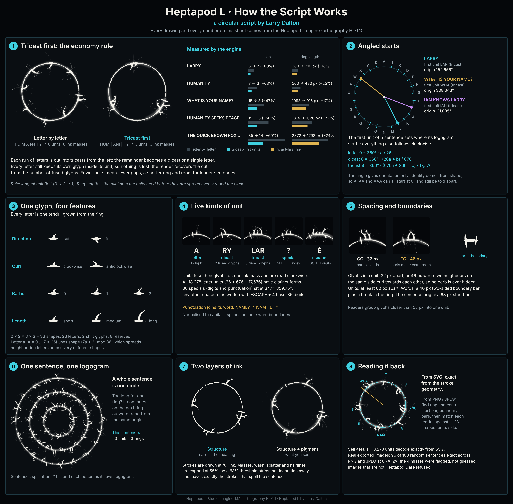
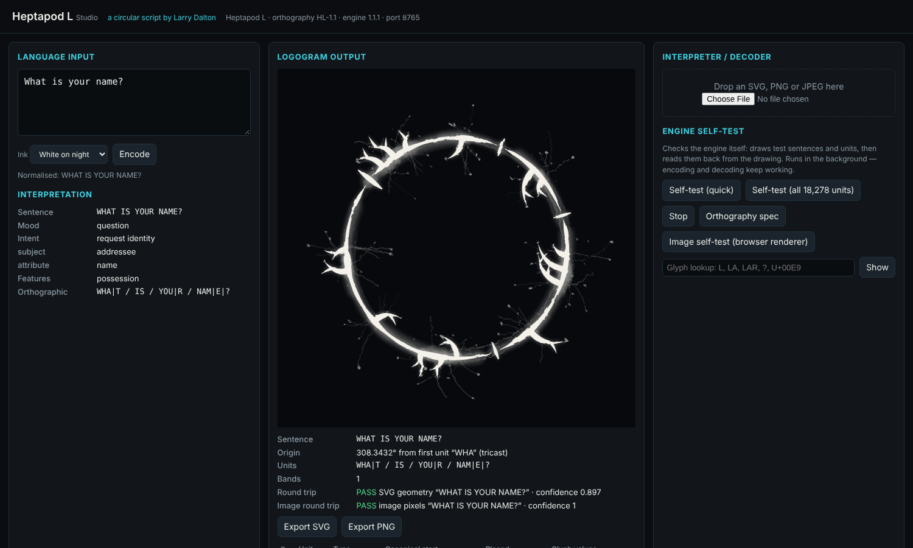
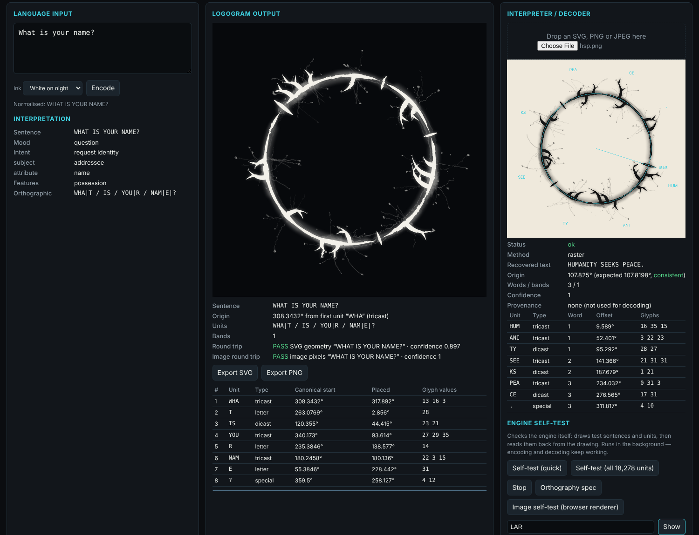
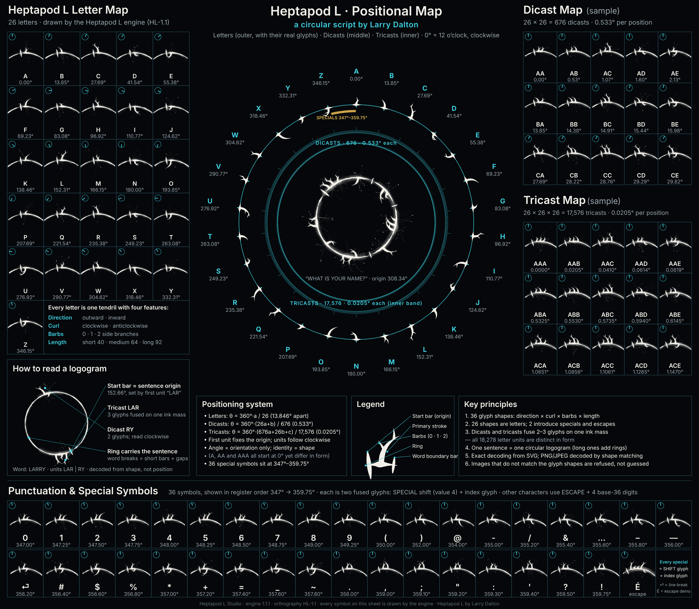
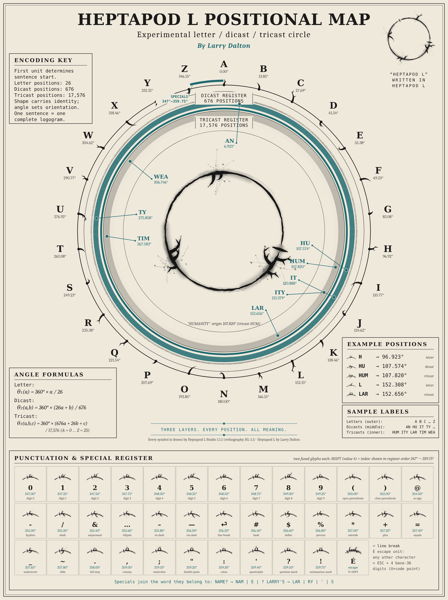

<p align="center"></p>

<h1 align="center">Heptapod L</h1>
<p align="center"><b>A circular script by Larry Dalton</b><br>
A complete, reversible writing system in which every sentence becomes one circular logogram,<br>
and the Windows studio that writes it and reads it back.</p>

<p align="center">
<a href="../../releases/latest"><b>Download for Windows</b></a> ·
<a href="docs/SPECIFICATION.md">Specification</a> ·
<a href="docs/HOW-IT-WORKS.md">How it works</a> ·
<a href="docs/DECODER.md">Decoder and test results</a>
</p>



---

## What Heptapod L is

Heptapod L began with the circular writing of the heptapods in the film *Arrival* (2016) and went further. The film gives us an
image: ink rings with organic tendrils, one ring per thought. It does not give us an alphabet. Heptapod L is an
original writing system that keeps that look and adds what the film never provided:

- **An alphabet.** 26 letters, each a distinct tendril shape, plus digits, punctuation and an escape for any Unicode character.
- **A grammar of position.** The first unit of a sentence fixes where its logogram starts on the circle. Everything else follows clockwise.
- **Compression.** Letters fuse into two-letter *dicasts* and three-letter *tricasts*, with 18,278 distinct letter units in all, so sentences use fewer marks.
- **Full reversibility.** Every logogram can be read back to the exact text, from the drawing itself.

Heptapod L is a fan-inspired, independent project. It is not affiliated with or endorsed by the makers of *Arrival* and does not reproduce the film's glyphs.

## The script in eight ideas

| # | Idea | In one line |
|---|------|-------------|
| 1 | **Tricast first** | Letters are grouped three at a time (then two, then one): `HUMANITY` → `HUM` · `ANI` · `TY`. That's 3 units instead of 8 and a ring about 25% shorter. |
| 2 | **Angled starts** | The first unit sets the sentence's orientation: `LARRY` starts at 152.656° because it opens with the tricast `LAR`. |
| 3 | **One glyph, four features** | Every letter is a tendril defined by direction, curl, barbs and length. That gives 36 shapes, 26 of which are letters. |
| 4 | **Five unit types** | Letter, dicast, tricast, special (digits and punctuation) and escape (any other character). |
| 5 | **Spacing and boundaries** | Fixed gaps inside units, wider gaps between units, a short bar between words and a long bar at the start. |
| 6 | **One sentence, one logogram** | Long sentences continue on further rings outward. |
| 7 | **Two layers of ink** | The strokes carry the meaning; the pigment around them is decoration that a reader can strip away. |
| 8 | **Read it back** | Exact decoding from SVG, and shape-matching decoding from PNG or JPEG images. |

Each idea is explained with examples in **[docs/HOW-IT-WORKS.md](docs/HOW-IT-WORKS.md)**. The exact rules are in **[docs/SPECIFICATION.md](docs/SPECIFICATION.md)**.

## Heptapod L Studio



The Studio is a local web application served by Windows PowerShell at `http://localhost:8765/`. It has three panels:

- **Language input:** type any text and see how it is normalised and segmented, plus a basic reading of its meaning (statement or question, intent, roles).
- **Logogram output:** the rendered logogram, its origin angle and a table of every unit. Each render is checked by decoding it again, both from the SVG and from its pixels. Export as SVG or PNG, in white-on-night or black-on-paper ink.
- **Interpreter / decoder:** drop in an SVG, PNG or JPEG. The Studio overlays what it detected (ring, start, units) and returns the text with a confidence score, or tells you it cannot read the image. It never guesses.

There is also a glyph lookup, an orthography reference and self-tests that run in the background.

Everything runs locally. There are no cloud services, no AI and no internet access at run time.



## Install (Windows 10/11)

**Option 1: setup program (recommended).** Download `HeptapodL-Setup.exe` from the [latest release](../../releases/latest) and run it.

- It installs for your Windows account only, so no administrator rights are needed.
- It starts the Studio automatically at sign-in and opens it in your browser.
- It places the three infographics on your Desktop.
- It adds a Start-menu entry and an uninstaller in *Settings → Apps*.

The setup program is not code-signed, so Windows SmartScreen may warn on first run: choose **More info → Run anyway**.

**Option 2: ZIP.** Download `HeptapodL-Package.zip`, extract it and double-click **Install.cmd**. Use this if your organisation blocks unsigned programs.

**Option 3: one script.** Copy the contents of [`installer/HeptapodL-Install.ps1`](installer/HeptapodL-Install.ps1) and paste it into Windows PowerShell 5.1.

All three run the same verified install:

1. Back up any previous version.
2. Free port 8765, but only if the previous Studio holds it; the installer never stops other software or changes the port.
3. Write the files.
4. Compile the image decoder.
5. Start the server, then encode, decode and run a self-test.

If any step fails, the installer restores the previous version and reports why.

## Infographics

| | |
|---|---|
| [](infographics/Heptapod-L-How-It-Works.png) | **How the Script Works**: the eight core ideas, with real renders and measured figures. |
| [](infographics/Heptapod-L-Positional-Map.png) | **Positional Map (night)**: all 26 letters, dicast and tricast samples, the full positional circle and the 36-symbol special register. |
| [](infographics/Heptapod-L-Positional-Map-Paper.png) | **Positional Map (paper)**: the letter, dicast and tricast registers with worked example positions and the special register. |

Every symbol on these sheets is drawn by the Heptapod L engine itself; none is illustrated by hand.

## How well it reads back

| Test | Result |
|------|--------|
| Every letter, dicast and tricast (18,278 units) plus all 36 specials, decoded from SVG | **18,313 / 18,313 exact** |
| 100 random sentences rendered by Chrome, exported as PNG and JPEG at 0.7×, 1× and 2× in both ink styles, decoded from pixels | **96 / 100 exact**; all 4 misses were flagged as uncertain, with no confident wrong answers |
| Screenshots of the Studio page in both ink styles | Decoded |
| Images that are not Heptapod L (including AI-generated "heptapod" art) | Refused with an explanation |

Details and method: **[docs/DECODER.md](docs/DECODER.md)**.

## Repository layout

```
src/server.ps1          Engine, composer, SVG decoder, HTTP server (Windows PowerShell 5.1)
src/hsraster.cs         Image (PNG/JPEG) decoder, C# 5, compiled locally by PowerShell at start-up
src/index.html          Studio interface
installer/              Paste-in installer, Windows setup script (NSIS), ZIP launcher, uninstaller, icon
infographics/           The three infographics
docs/                   Specification, explanations, decoder notes, images
```

To build the setup program yourself: `makensis installer/heptapodl.nsi`, with the infographics and `Install.ps1` placed next to it as listed in the script.

## Limitations

- The Studio reads only logograms that Heptapod L itself produced. It does not translate hand-drawn or film heptapod writing, and it says so rather than inventing text.
- Image decoding becomes less reliable below about 500 px across. Use the SVG export for exact results.
- The meaning reading is rule-based and basic; the spelling, which is fully reversible, is the authoritative layer.
- Text is normalised to capitals.

## Author

**Heptapod L** was created by **Larry Dalton**.
© 2026 Larry Dalton. All rights reserved.
