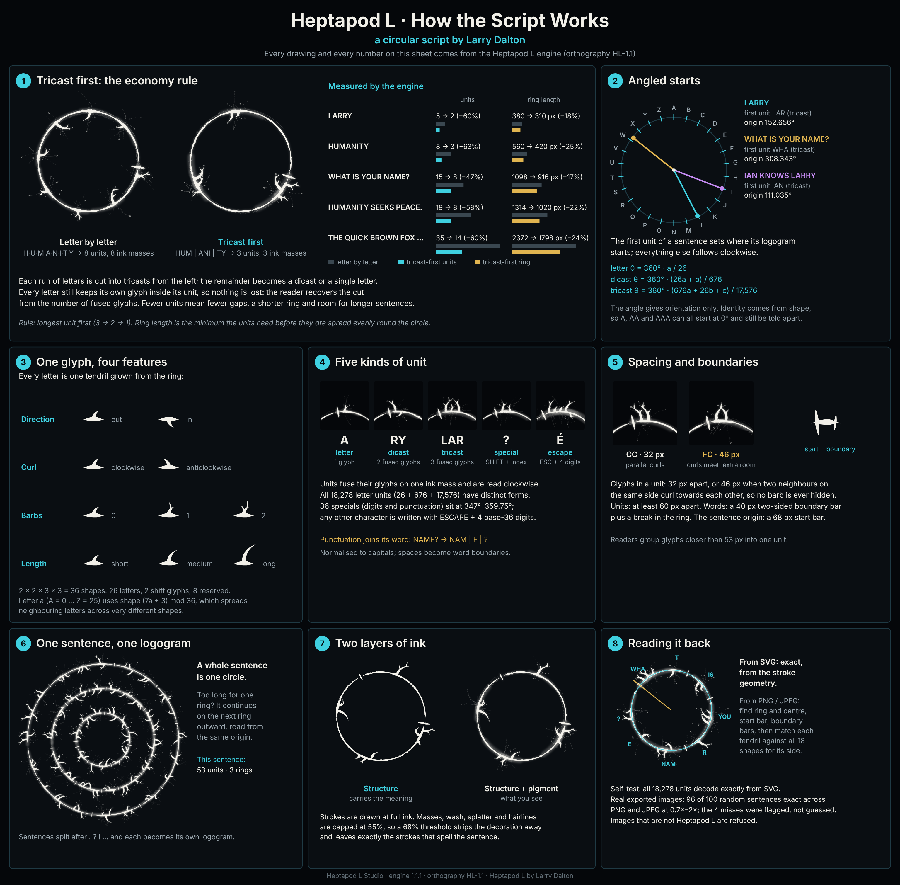

# How Heptapod L works

*An explanation of the script's design choices, with real examples from the engine. The exact rules are in [SPECIFICATION.md](SPECIFICATION.md).*



## 1. Tricast first: the economy rule

A circle has limited room. If every letter were written as its own unit, each would need its own ink mass and a gap on each side, so the ring fills up quickly. Heptapod L therefore groups letters three at a time.

```
HUMANITY   letter by letter:  H · U · M · A · N · I · T · Y     8 units
           tricast first:     HUM · ANI · TY                     3 units
```

Each letter still keeps its own glyph inside the unit, so no information is lost. A reader recovers the grouping from the number of glyphs fused on each ink mass.

The engine measured these savings:

| Sentence | Units (letters → tricast first) | Minimum ring length |
|---|---|---|
| LARRY | 5 → 2 (−60%) | 380 → 310 (−18%) |
| HUMANITY | 8 → 3 (−63%) | 560 → 420 (−25%) |
| WHAT IS YOUR NAME? | 15 → 8 (−47%) | 1098 → 916 (−17%) |
| HUMANITY SEEKS PEACE. | 19 → 8 (−58%) | 1314 → 1020 (−22%) |
| THE QUICK BROWN FOX JUMPS OVER THE LAZY DOG | 35 → 14 (−60%) | 2372 → 1798 (−24%) |

A shorter ring means more of a sentence fits on one circle before it needs another ring.

## 2. Angled starts

A Heptapod L logogram has no fixed top. **The first unit of the sentence decides where it starts:**

| Sentence | First unit | Origin |
|---|---|---|
| LARRY | `LAR` (tricast) | 152.656° |
| WHAT IS YOUR NAME? | `WHA` (tricast) | 308.343° |
| IAN KNOWS LARRY | `IAN` (tricast) | 111.035° |

The 26 letters divide the circle into 13.846° steps. Dicasts subdivide each step into 26 (0.533°), and tricasts subdivide again (0.0205°). The start angle therefore tells a reader, before anything else, roughly how the sentence begins.

A unit's angle is orientation, not identity. `A`, `AA` and `AAA` all start at 0°, yet they differ in shape. Building identity on shape is what makes the script readable even when angles are only approximately known, as in a photograph.

## 3. One glyph, four features

Each letter is one tendril with four independent features:

| Feature | Options |
|---|---|
| Direction | grows outward or inward |
| Curl | clockwise or anticlockwise |
| Barbs | 0, 1 or 2 side branches |
| Length | short, medium or long |

That makes 36 possible shapes: 26 are letters, 2 are shift signs for specials and escapes, and 8 are kept in reserve.

Letters are assigned shapes by the rule `(7a + 3) mod 36`, so A, B, C … are not look-alikes.

## 4. Five kinds of unit

| Unit | What it is |
|---|---|
| Letter | one glyph |
| Dicast | two glyphs on one ink mass |
| Tricast | three glyphs on one ink mass |
| Special | the SPECIAL shift glyph plus an index glyph (digits and punctuation) |
| Escape | the ESCAPE shift glyph plus four base-36 digits, which can write any Unicode character |

Punctuation belongs to its word: `NAME?` is written `NAM` · `E` · `?`.

## 5. Spacing and boundaries

- Glyphs inside a unit are 32 units apart.
- Two neighbours on the same side of the ring that curl towards each other are given 46 units, so their tendrils never cross where the barbs sit.
- Units are at least 60 units apart.
- Words are separated by a short two-sided bar plus a break in the ring.
- The sentence origin is marked by a longer two-sided start bar.

## 6. One sentence, one logogram

A whole sentence is one circle. When it is too long for one ring, it continues on the next ring outward, read from the same origin. Separate sentences become separate logograms.

## 7. Two layers of ink

The look of Heptapod L comes from ink masses, wash, splatter and fine hairlines. These are **decoration**: they are drawn at no more than 55% strength. The **meaning** is carried only by the solid strokes: the ring, the bars and the glyphs.

A reader that ignores anything lighter than 68% sees exactly the strokes that spell the sentence. This is how the Studio reads photographs and screenshots.

## 8. Reading it back

- **From SVG:** exact, using the stroke geometry.
- **From PNG or JPEG:** the decoder works in these steps:
  1. Find the ring and its centre.
  2. Find the start bar and the boundary bars.
  3. Match each tendril against all 18 possible shapes for its side.
  4. Refine the matches so that neighbouring glyphs never share ink.

  If the strokes don't match Heptapod L shapes, the image is refused rather than guessed.

See [DECODER.md](DECODER.md) for the method and test results.
